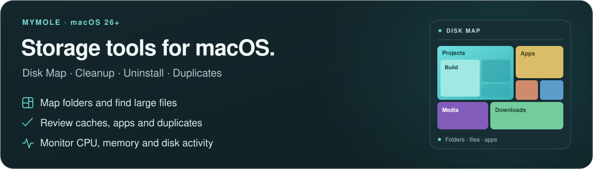

#  MyMole

MyMole analyzes disk usage, removes apps and selected files, and displays
system activity. Scans do not delete files.

**[Download for Apple silicon](https://github.com/compilererrors/MyMole/releases/latest)** ·
[Editions and permissions](#editions-and-permissions) · [License](#license)

Requires **macOS 26 or later**. The interface is in English; numbers, sizes and
dates follow your system's locale.

All screenshots below show fictional apps, files, projects, cleanup history and
system readings.

## Dashboard and Smart Scan

View disk usage, CPU, memory and recent cleanups. Smart Scan checks caches,
installers, apps, maintenance tasks and duplicate files. Open each result to
choose what to remove.

## Deep Clean

Find app caches, logs, crash reports and developer caches. Choose which files
to move to the Trash. Keep rules exclude files and folders from cleanup.

## System Clean

Remove selected system caches and logs. Available in the GitHub edition only.
Files are permanently deleted after confirmation and administrator approval.
Undo is not available.

## Uninstall

Remove apps individually or in batches. Review their caches, settings and data
before removal. Personal data starts unselected.

Also includes app reset, searches for files left by removed apps, and lists of
app copies and file associations.

## Startup Items

List startup jobs and plug-ins, including entries that point to missing programs.
Move your own login agents to the Trash. System jobs are read-only.
Manage app-registered login items in macOS System Settings.

## Optimize

Preview maintenance tasks, including refreshing Finder thumbnails, rebuilding
“Open With” associations and removing old saved window states. Each task lists
its effect and whether it supports Undo. Running tasks requires confirmation.

## Projects

Measure build outputs, dependencies, virtual environments and caches by project.
Compare sizes between scans. Choose generated files for removal and protect
files or folders with keep rules.

## Installers

Find downloaded disk images, installation packages, archives and device software.
Sort and filter the list, then move selected files to the Trash.

## Duplicates

Find files with identical contents, regardless of name or extension. Compare
copies and choose which to move to the Trash. MyMole verifies their contents
before removal and keeps at least one copy per group.

### Similar Photos

Find similar images, including resized and re-exported copies. Compare previews
and dimensions before removal. Similar images are not necessarily identical
files. One image per group stays. The Photos library is excluded.

## Disk Map

View folder sizes in six chart layouts beside a file list or folder tree.
Point at a nested box to show its name. Find large files, save scans and compare
changes between scans.

Move selected files or folders to the Trash. Use Choose All Contents to clean
inside a folder without removing the folder itself.

## Live Status

Display CPU, memory, storage, disk activity, network and battery readings.
Unavailable readings are marked in the app. Change card sizes, order and
visibility. The GitHub edition also lists active processes. An optional menu
bar item shows status summaries.

## History and Undo

List cleanup runs with item counts, sizes and restore results. History stores
counts and sizes, not filenames.

During the current session, Undo restores files from the last ten Trash
operations in each section. After quitting MyMole, use Finder's Put Back for
files still in the Trash.

Files in the Trash still use disk space. Emptying the Trash permanently deletes
them.

## Settings

Set appearance, confirmations, loading behavior and protected locations.
Configure scheduled scans and notifications, and manage saved results.
Scheduled scans do not delete files.

## Editions and permissions

### Direct download from GitHub

Includes System Clean and administrator maintenance tasks. macOS asks for an
administrator password when you delete system files, run administrator tasks
or remove an app that requires administrator approval.

### App Store and TestFlight

- Select the folders MyMole is allowed to scan.
- App removals that need an administrator password use Finder. The first time,
  macOS asks you to allow MyMole to control Finder. Finder handles the password prompt.
- System Clean is not included. Optimize includes only Old Window States and
  Broken Settings Files.

### macOS privacy settings

Full Disk Access allows scans of protected folders. App Management controls
changes to installed apps. Both are configured in macOS System Settings.

## Keyboard navigation

- Use Tab and Shift-Tab between controls, and arrow keys in lists, trees and the
  app grid. Enable Keyboard navigation in macOS Settings to include ordinary buttons.
- Return opens the selected row; Space previews files. Control-Return or Shift-F10
  opens a file row's menu, and Option-Command-C copies its absolute path.
- Command-K opens the command palette; Command-F focuses search.
- Escape or Command-W closes the frontmost dialog. A running removal keeps its
  review open until the operation finishes.

## License

MyMole is source-available. Personal and other non-commercial use is free.
Business use requires a paid commercial license or an authorized store purchase.
See [LICENSE](LICENSE).
