#  MyMole

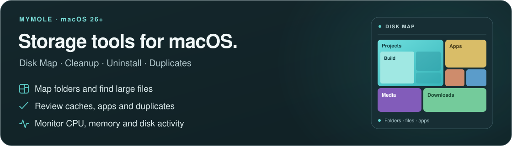

MyMole analyzes disk usage, removes apps and selected files, and displays
system activity. Scans do not delete files.

**[Download for Apple silicon](https://github.com/compilererrors/MyMole/releases/latest)** ·
**[Install with Homebrew](#install-with-homebrew)** ·
[Editions and permissions](#editions-and-permissions) · [License](#license)

Requires **macOS 26 or later**. The interface is in English, Simplified and
Traditional Chinese, Dutch, French, German, Hindi, Italian, Japanese, Korean,
Brazilian Portuguese, Spanish and Swedish. It follows your Mac's language, or
the one you choose in Settings. Numbers, sizes and dates follow your system's
locale.

All screenshots below show fictional apps, files, projects, cleanup history and
system readings.

## Install with Homebrew

On Apple silicon, install the GitHub edition with Homebrew:

```sh
brew tap compilererrors/mymole https://github.com/compilererrors/MyMole.git
brew install --cask compilererrors/mymole/mymole
```

To get a newer build through Homebrew, run:

```sh
brew update
brew upgrade --cask compilererrors/mymole/mymole
```

## Dashboard and Smart Scan

View disk usage, CPU, memory and recent cleanups. Smart Scan checks caches,
installers, apps, maintenance tasks and duplicate files. Open each result to
choose what to remove.

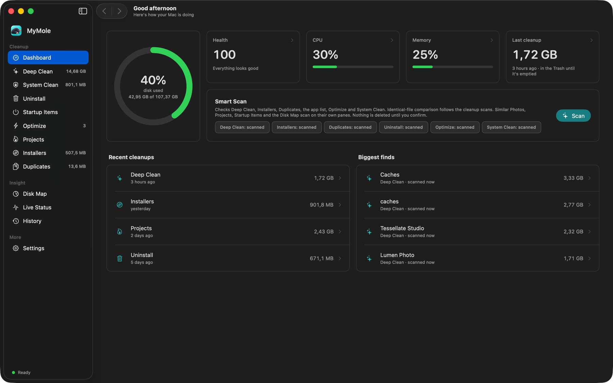

## Deep Clean

Find app caches, logs, crash reports and developer caches. Choose which files
to move to the Trash. Keep rules exclude files and folders from cleanup.

Simulators, Android emulator snapshots, device backups and Xcode archives are
listed but never chosen for you.

The GitHub edition also lists what programs left in the temporary folders and
haven't touched for three days, or the number of days set in Settings (0 to 90). Folders a
running program works in are left out, and none is ever chosen for you.

iCloud Downloads lists files in iCloud Drive that are also downloaded to this
Mac. Removing a download keeps the file in iCloud Drive and in Finder; opening
it downloads it again. Files not yet uploaded in full can't be chosen.

Developer Tools lists what Docker, Xcode's simulators, Android, virtual
machine apps and local AI models keep, with sizes:

- Unused build cache and untagged images no container uses start chosen.
- Stopped containers, unused images and anonymous volumes, simulator runtimes
  no simulator uses, simulators whose runtime is gone, and Android devices and
  system images no device uses are removed only if you choose them.
- Named volumes, anything in use, running emulators and virtual machines are
  only shown.
- Each removal goes through the tool's own command (`docker`, `xcrun simctl`,
  `avdmanager`, `sdkmanager`) after the tool's list is read again. It can't be
  undone. The App Store edition only lists these and removes nothing.
- Ollama models are listed by name with the layers they share, Hugging Face's
  cache by repository and LM Studio's models by folder, with unfinished
  downloads apart. A model goes to the Trash only if you choose it, with the
  files that are only its own, and only while its app isn't running.

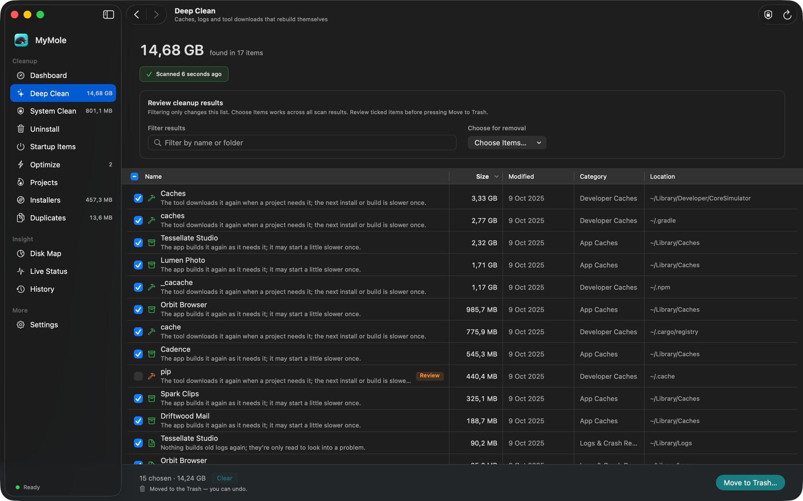

## System Clean

Remove selected system caches and logs. Available in the GitHub edition only.
Files are permanently deleted after confirmation and administrator approval.
Undo is not available.

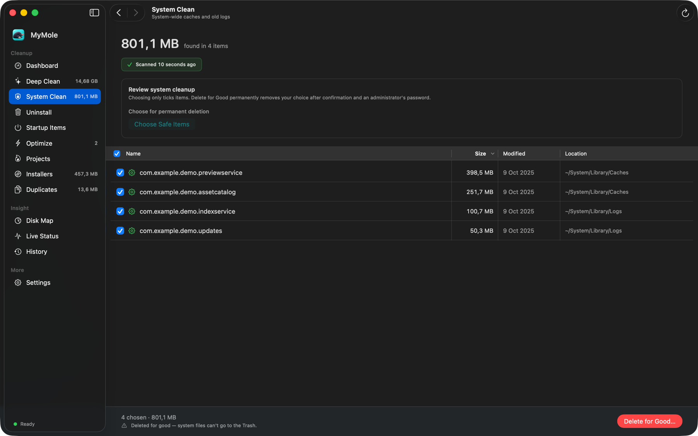

## Uninstall

Remove apps individually or in batches. Review their caches, settings and data
before removal. In a batch, apps only Finder can move go to Finder together, so it asks
for approval once. What certainly belongs to the app, tied by its bundle ID, a
part it carries or an app group its signature names, starts selected. Name
matches, parts the maker's other apps may use, temporary data and folders that
look like documents or projects start unselected, marked with the reason.

For well-known vendors, Uninstall also finds the parts their own uninstall
lists name, such as audio drivers, browser plug-ins and updaters, and the
installer's record of the app when that record installed this app alone. Parts
shared by a vendor's apps are offered only with the last of those apps.
Kernel and system extensions and folders every user shares are only shown,
with what to do instead. When an app ships its own uninstaller, MyMole points
to it. Removing system-wide parts needs the GitHub edition.

Plug-ins an app installed in your Library (web, Quick Look, Spotlight and audio
plug-ins, screen savers, services, preference panes) and its background
services' containers are found by the ID macOS reads in them, never by name.

Also includes app reset, searches for files left by removed apps, and lists of
app copies and file associations.

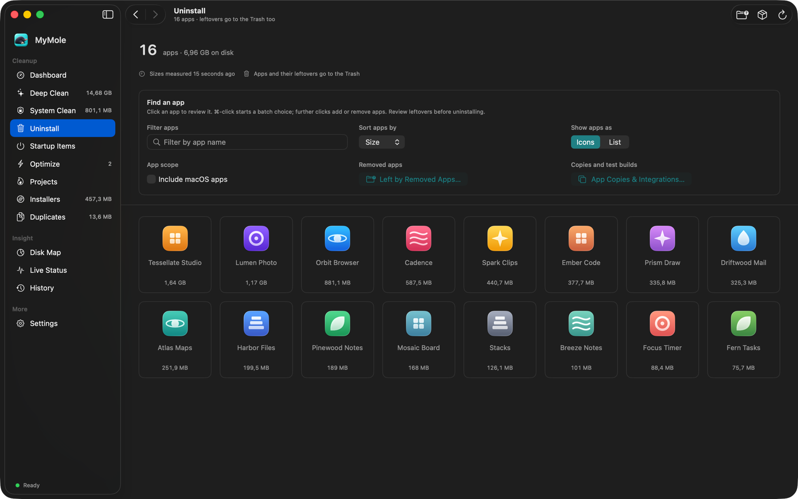

## Startup Items

List startup jobs and plug-ins, including entries that point to missing programs.
Move your own login agents to the Trash. System jobs are read-only.
Manage app-registered login items in macOS System Settings.

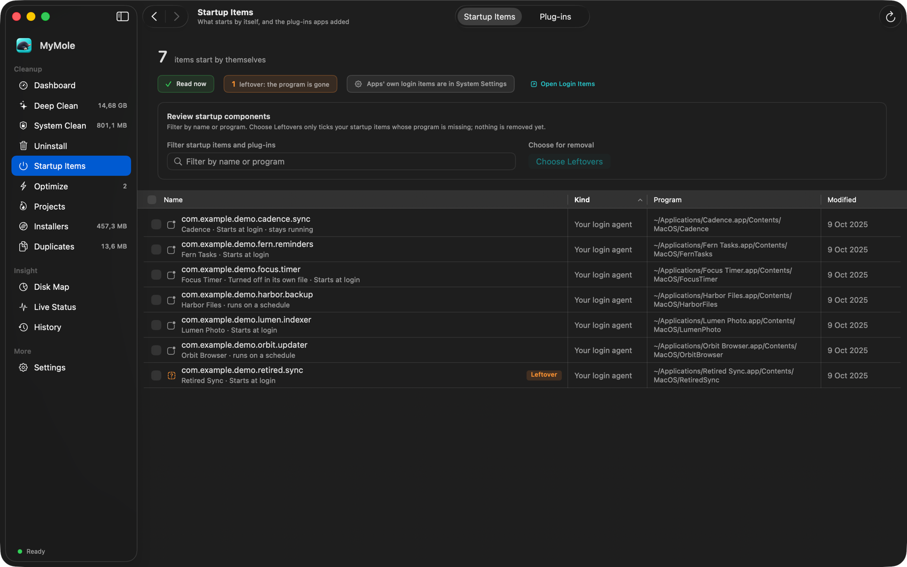

## Optimize

Preview maintenance tasks, including refreshing Finder thumbnails, rebuilding
“Open With” associations and removing old saved window states. Each task lists
its effect and whether it supports Undo. Running tasks requires confirmation.

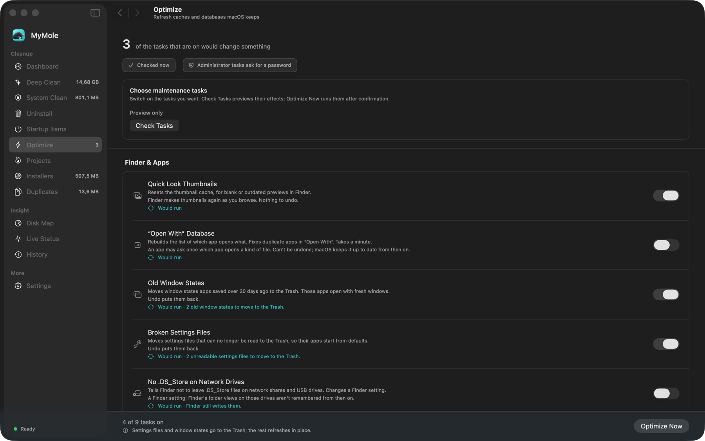

## Projects

Measure build outputs, dependencies, virtual environments and caches by project.
Compare sizes between scans. Choose generated files for removal and protect
files or folders with keep rules.

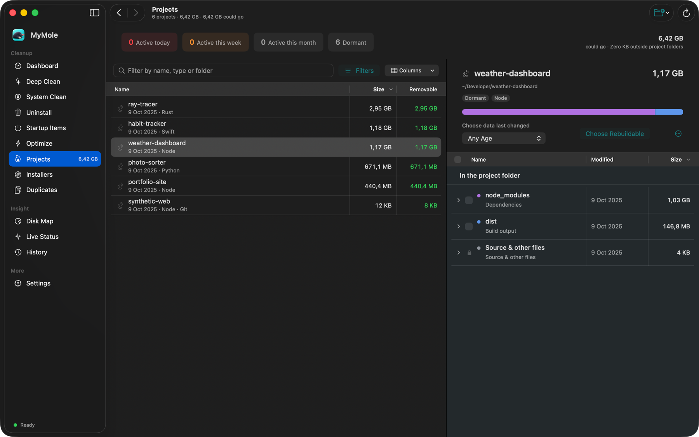

## Installers

Find downloaded disk images, installation packages, archives and device software.
Sort and filter the list, then move selected files to the Trash.

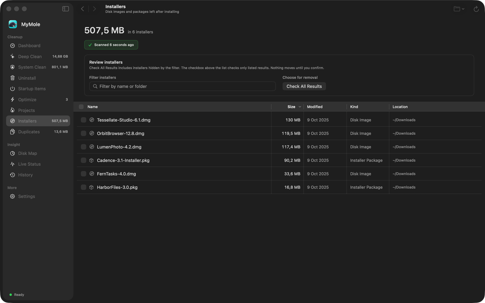

## Duplicates

Find files with identical contents, regardless of name or extension. Compare
copies and choose which to move to the Trash. MyMole verifies their contents
before removal and keeps at least one copy per group.

Share Storage keeps every file instead. Each chosen copy becomes an APFS clone
of the copy that stays, with its own name, place, dates and tags, so the copies
take the space of one. The copies they replace go to the Trash; the space is
free once it's emptied. Copies on another disk, with other names or locked stay
as they are, and the sheet says why.

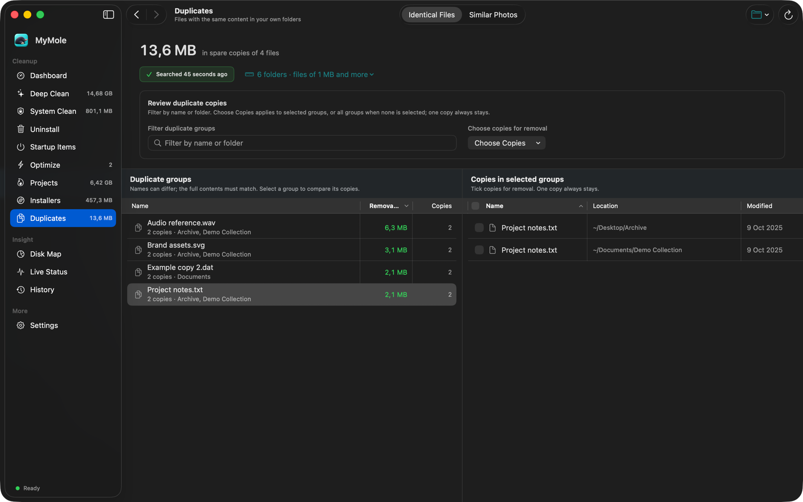

### Similar Photos

Find similar images, including resized and re-exported copies. Compare previews
and dimensions before removal. Similar images are not necessarily identical
files. One image per group stays. The Photos library is excluded.

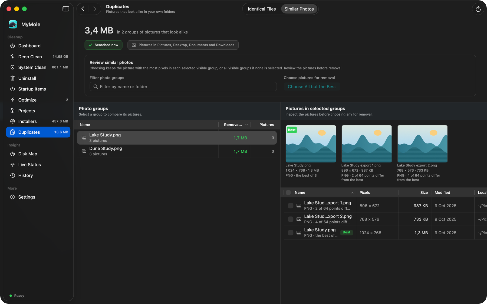

## Disk Map

View folder sizes in six chart layouts beside a file list or folder tree.
Point at a nested box to show its name. Find large files, save scans and compare
changes between scans.

System Data… in the Disk Map menu shows what macOS counts as System Data,
place by place: swap, temporary files, caches, app data, developer data,
backups, Mail and macOS's own downloads, with sizes, the largest files and
where the space can be won back. Nothing is removed from there.

Export a report of the folders and largest files as CSV or PDF from the Disk
Map menu. You choose how deep it goes, whether paths are whole and whether
hidden items are in it.

Move selected files or folders to the Trash. Use Choose All Contents to clean
inside a folder without removing the folder itself.

On this Mac's own disks, Rescan Entire Map reads again only the folders macOS's
file system events say changed since the last complete scan. When those events
can't say for sure, as on network and external disks, the whole map is read.

The filters of Disk Map, Large Files, Deep Clean, Projects, Installers and
Duplicates also take conditions, for example
`size:>500MB`, `kind:media`, `ext:mov,mp4`, `age:>6m` and `hidden:no`. Put `-`
before a word or a condition to leave out what matches it, and quotes around
words to keep their spaces. The line under the filter shows how it was read.
A condition the filter doesn't know lists nothing until it's fixed.

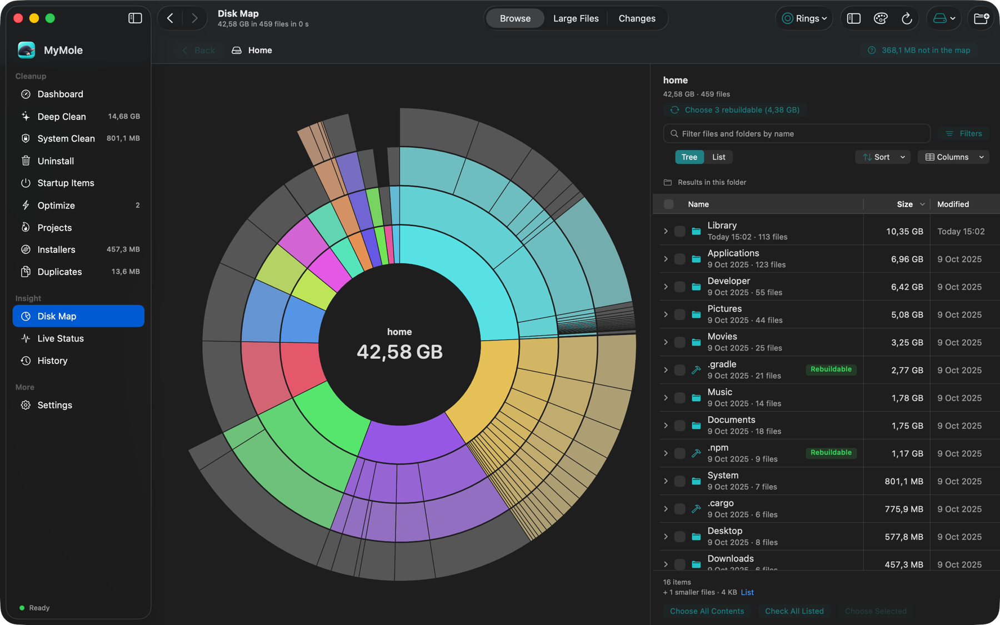

## Live Status

Display CPU, memory, storage, disk activity, network and battery readings.
Unavailable readings are marked in the app. Change card sizes, order and
visibility. The GitHub edition also lists active processes. An optional menu
bar item shows status summaries.

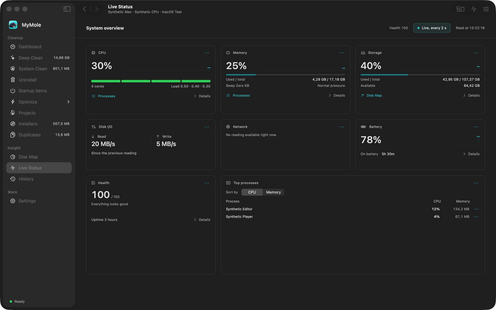

## History and Undo

List cleanup runs with item counts, sizes and restore results. History stores
counts and sizes, not filenames.

During the current session, Undo restores files from the last ten Trash
operations in each section. After quitting MyMole, use Finder's Put Back for
files still in the Trash.

Files in the Trash still use disk space. Emptying the Trash permanently deletes
them.

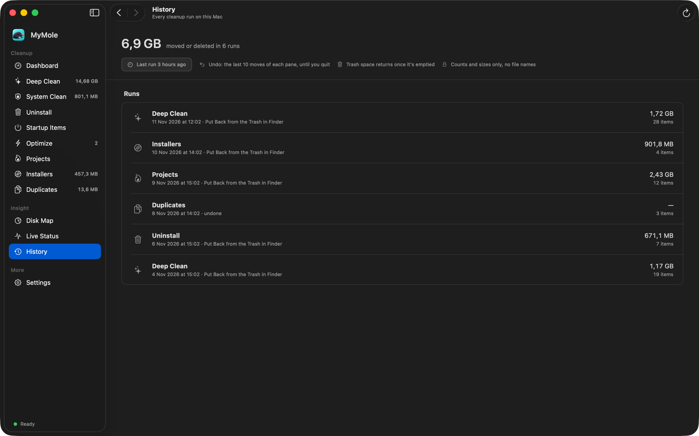

## Settings

Set appearance, confirmations, loading behavior and protected locations.
Configure scheduled scans and notifications, and manage saved results.
Scheduled scans do not delete files.

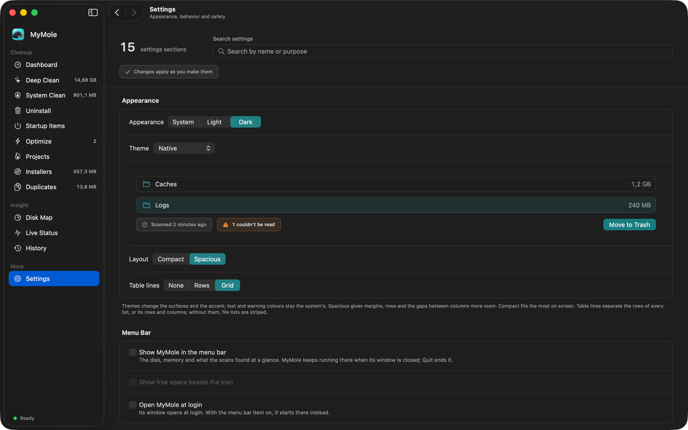

## Editions and permissions

### Direct download from GitHub

Includes System Clean and administrator maintenance tasks. macOS asks for an
administrator password when you delete system files, run administrator tasks
or remove an app that requires administrator approval.

### App Store and TestFlight

- Select the folders MyMole is allowed to scan.
- App removals that need an administrator password use Finder. The first time,
  macOS asks you to allow MyMole to control Finder. Finder handles the password prompt.
- System Clean is not included. Optimize includes only Old Window States and
  Broken Settings Files.

### What stays on your Mac

MyMole makes no network connections. Website and Support open in your
browser. The App Store edition is also sandboxed without network access.

Saved scans, keep lists, project rules and picture fingerprints hold names and
paths of your files, in MyMole's own folder in Application Support. Cleanup
history holds only counts and sizes. Large lists set aside on disk are removed
when they close. A report is written only where you save it. Settings →
Privacy shows the folder and the permissions the edition uses.

### macOS privacy settings

Full Disk Access allows scans of protected folders. App Management controls
changes to installed apps. Both are configured in macOS System Settings.

Without Full Disk Access, Disk Map can still map one folder you choose.
Folders macOS protects inside it stay closed and are listed as skipped;
nothing else scans until access is given.

## Keyboard navigation

- Use Tab and Shift-Tab between controls, and arrow keys in lists, trees and the
  app grid. Enable Keyboard navigation in macOS Settings to include ordinary buttons.
- Return opens the selected row; Space previews files. Control-Return or Shift-F10
  opens a file row's menu, and Option-Command-C copies its absolute path.
- Command-K opens the command palette; Command-F focuses search.
- Escape or Command-W closes the frontmost dialog. A running removal keeps its
  review open until the operation finishes.

## License

MyMole is source-available. Personal and other non-commercial use is free.
Business use requires a paid commercial license or an authorized store purchase.
See [LICENSE](LICENSE).
