# MyMole

MyMole helps you understand what uses your Mac's storage, review what can go,
and keep an eye on system activity. Explore first, choose what to remove, and
review the operation before anything changes.

**[Download for Apple silicon](https://github.com/compilererrors/MyMole/releases/latest)** ·
[Editions and permissions](#editions-and-permissions) · [License](#license)

Requires **macOS 26 or later**. The interface is in English; numbers, sizes and
dates follow your system's locale.

All screenshots below show fictional apps, files, projects, cleanup history and
system readings.

## Dashboard and Smart Scan

See disk usage, system health, CPU, memory and recent cleanups in one place.
Smart Scan checks cleanup candidates, installers, installed apps, maintenance
and identical files, then links to each result for review. Scanning never removes
anything by itself.

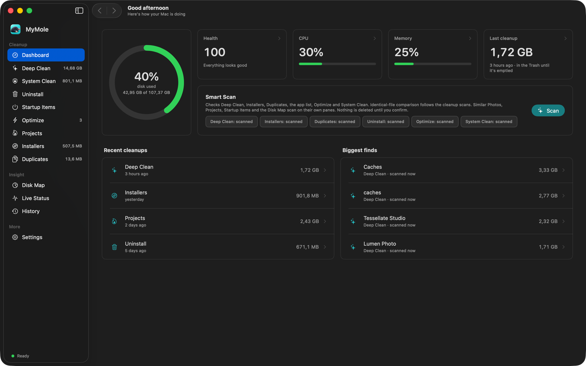

## Deep Clean

Review application caches, logs, crash reports, developer caches and other
supported cleanup categories. See the size and reason for each finding, choose
what to move, and keep files or folders you want MyMole to leave alone.
Ordinary cleanup uses the Trash and supports Undo.

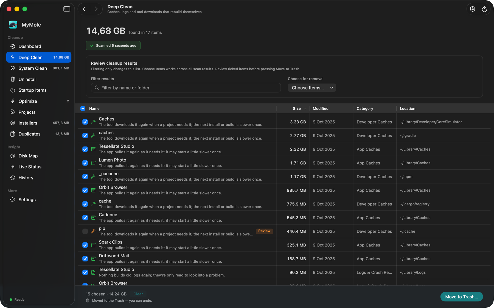

## System Clean

The direct edition can inspect supported system caches and logs as well as your
own Library. System cleanup is separate from ordinary Trash moves: it requires
confirmation and administrator approval, and permanently deleted items cannot
be restored with Undo. This section is not available in the App Store edition.

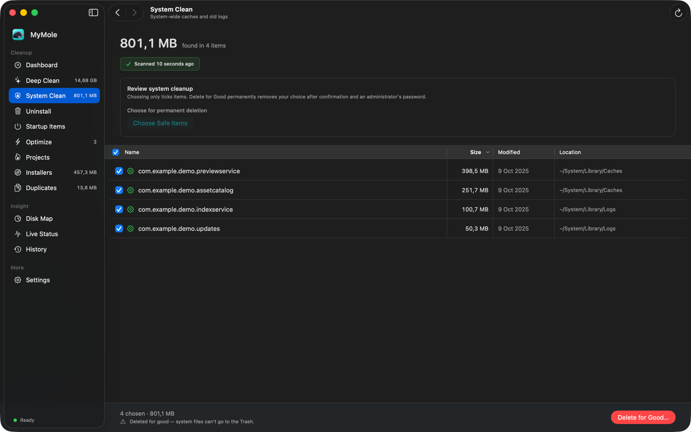

## Uninstall

Browse installed apps, review an app's related files, or choose several apps for
a batch review. Identity-linked caches and logs can start selected; personal
data, shared files and uncertain matches need your explicit choice. Select a
finding to see its full path and why it matched.

Reset an app while keeping it installed, review files left by apps removed in
Finder, or compare app copies and declared integrations. Keep rules, running
apps and files shared with another installed app are checked before removal.
Ordinary app removal uses the path already shown in the review.

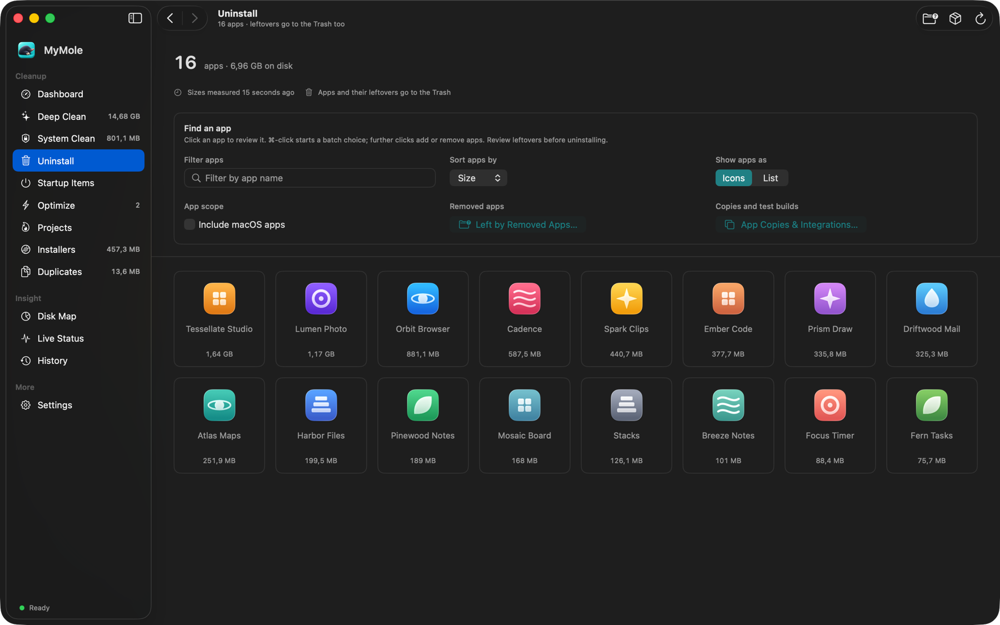

## Startup Items

Inspect launch agents, launch daemons and supported plug-ins, including entries
whose program is missing. Your own removable agents can go to the Trash with
Undo; system entries remain available for inspection. App-managed login items
are linked to macOS Login Items settings.

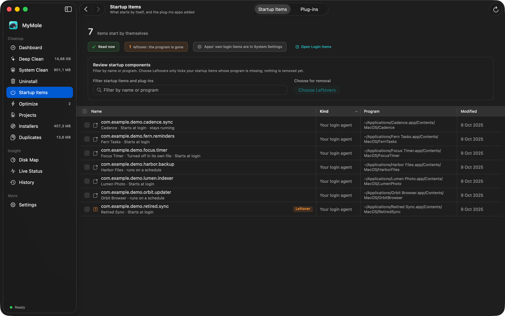

## Optimize

Check maintenance tasks before running them. Each task explains its effect and
whether it can be undone, from refreshing Finder previews and app associations
to reviewing old window states and broken settings files. Choose which tasks
to enable; Optimize Now asks for confirmation. Administrator tasks are available
in the direct edition, while the App Store edition offers supported tasks on
your own files.

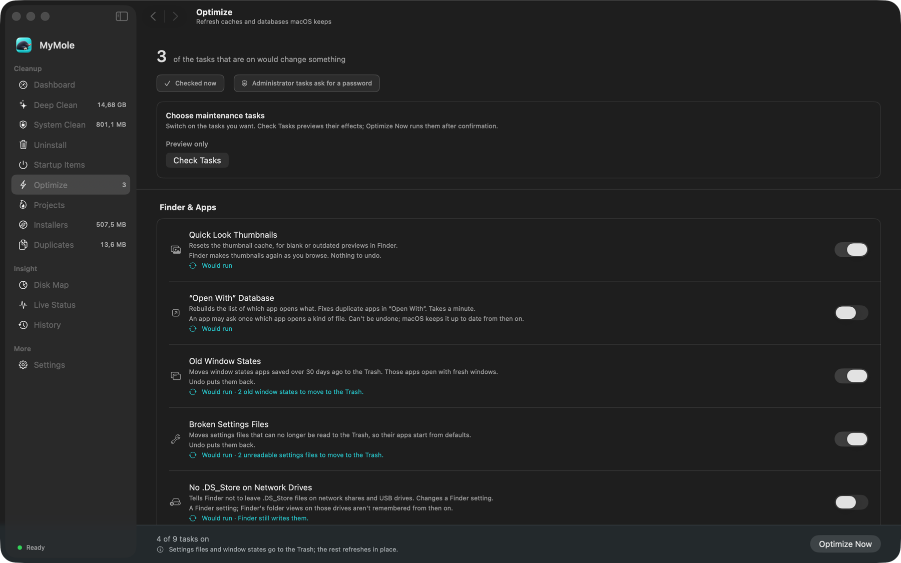

## Projects

Find space used by build outputs, downloaded dependencies, virtual environments
and caches across development projects. Inspect each project's contents, compare
sizes between scans and choose rebuildable files for cleanup. Project rules and
keep lists let you protect work you want to retain.

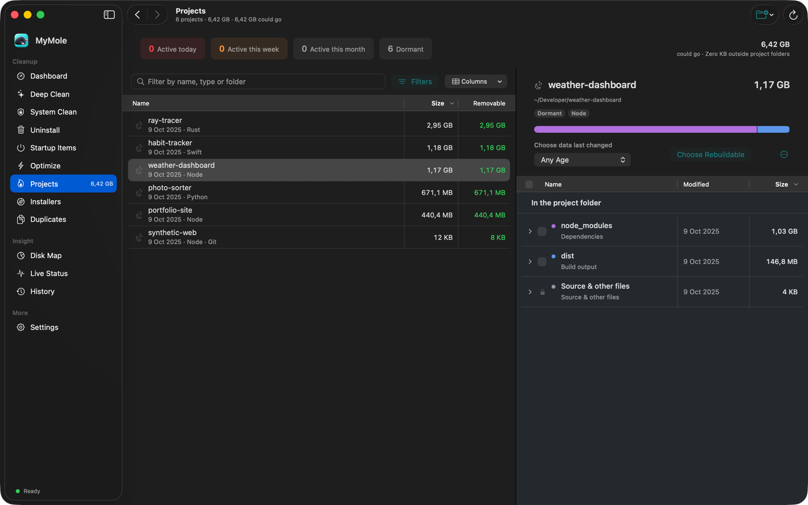

## Installers

Find downloaded disk images, packages, archives and device software. Sort and
filter the results, inspect their locations and move chosen downloads to the
Trash. Undo can put them back during the current session.

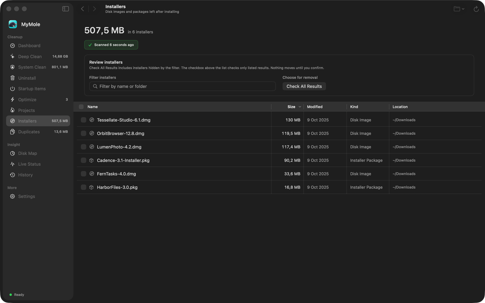

## Duplicates

Identical Files groups files by their contents, even when names or extensions
differ. Size and hash checks narrow the search, and full byte comparisons verify
the matches. Compare copies side by side, choose which to remove and retain at
least one copy in every group. Files are checked again before a move.

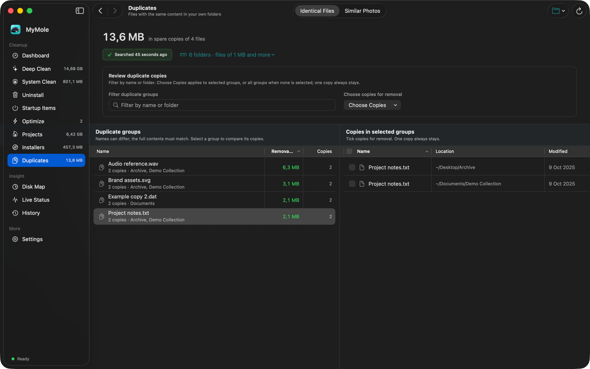

### Similar Photos

Find separate image files that look alike, including resized or exported
versions. Compare previews and image dimensions before choosing what goes.
Visual similarity is a review aid, not proof that files are identical. One image
always stays, and the Photos library is excluded.

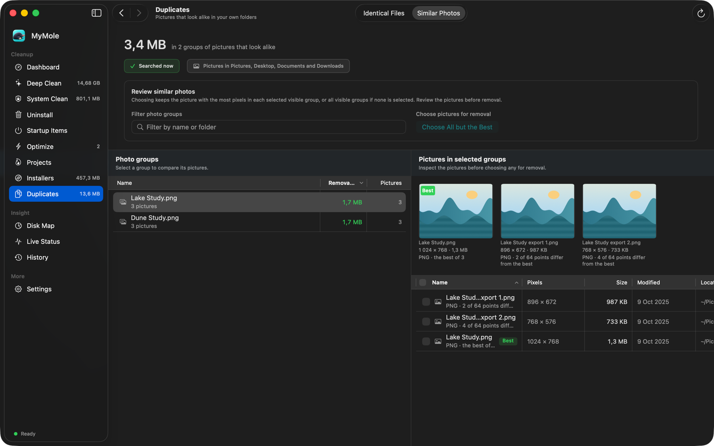

## Disk Map

Explore folder sizes as Boxes, Rings, Columns, Wheel, Pie or Bars beside a file
list or expandable tree. Point at nested Boxes to reveal names inside the map;
very small blocks use their parent's label area. Filter large files, save scans,
exclude folders and compare changes between scans.

Review individual files, folders or all contents of an open folder before moving
them. Choosing all contents leaves that folder itself in place. Hidden and small
files are included, with keep rules and current file checks applied before a move.

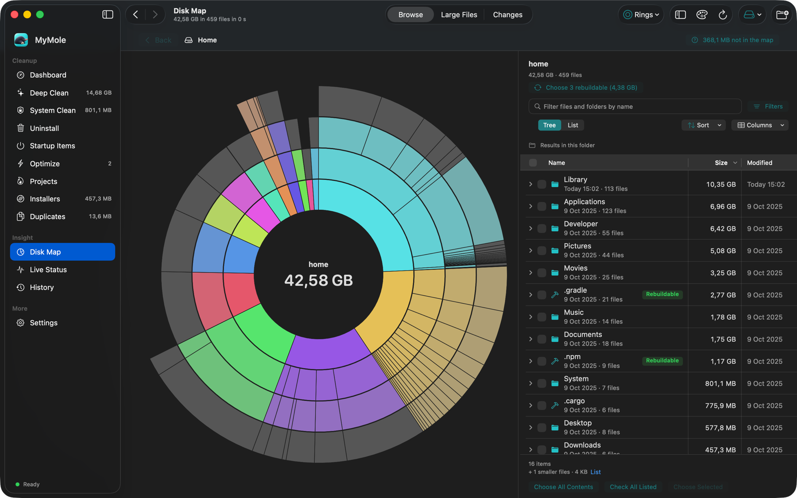

## Live Status

Watch CPU, memory, storage, disk activity, network and battery readings when
available. Customize card sizes, order and visibility, open Details for secondary
readings, and choose a network interface. The direct edition also shows active
processes. The optional menu bar item keeps status summaries close at hand.

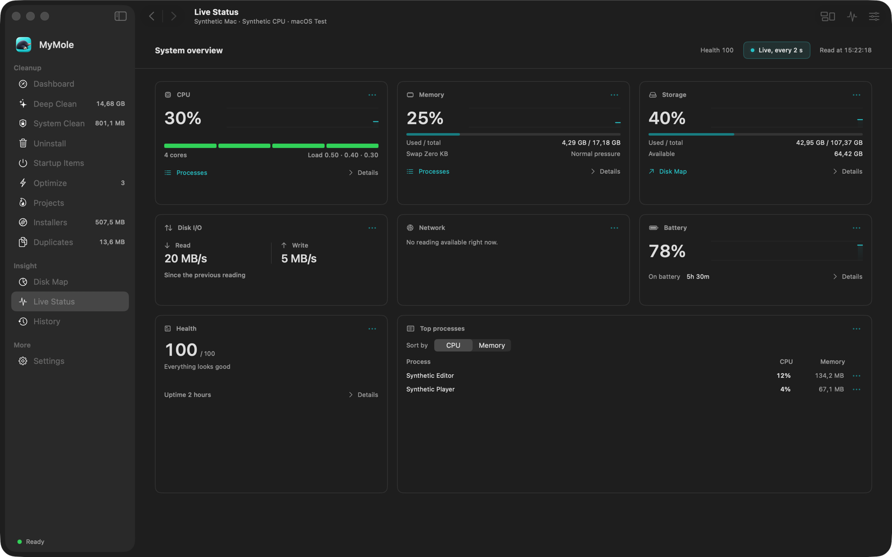

## History and Undo

See what each cleanup moved or deleted, how much it handled and what was restored.
History stores counts and sizes rather than filenames. During the current session,
Undo is available for the last ten ordinary moves in each pane. Items still in
the Trash can also be put back with Finder.

Moving something to the Trash does not immediately free disk space. Emptying the
Trash is a separate, permanent operation with its own confirmation.

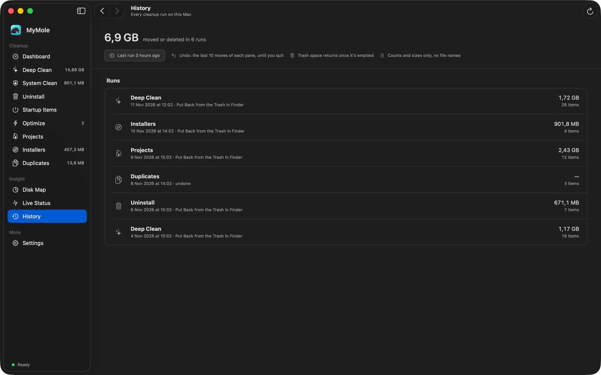

## Settings

Choose appearance, loading behavior, confirmations and protected locations.
Configure optional scheduled scans and notifications, or manage saved results.
Scheduled scans report findings; they never remove files automatically.

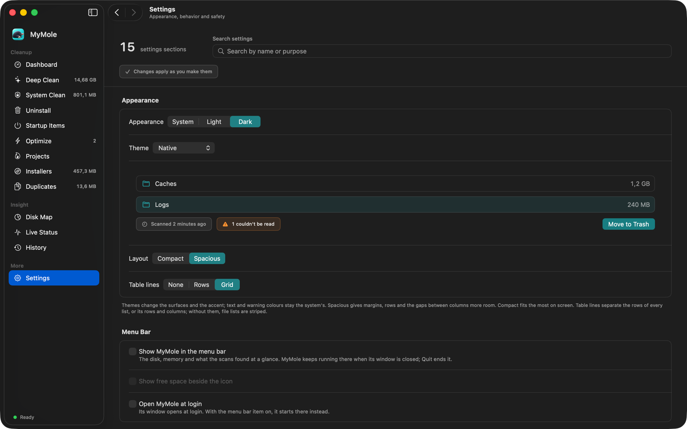

## Editions and permissions

### Direct download from GitHub

The direct edition includes a signed administrator helper and runs outside the
App Sandbox. It can request macOS administrator approval for supported protected
app moves, system cleanup and maintenance. The helper runs for the requested
operation; it is not installed as an always-running background service.

Full Disk Access may still be needed to inspect protected data, and macOS App
Management can still govern changes to other apps. Administrator approval does
not replace these privacy permissions. This edition does not need App Store
folder grants or the App Store edition's Finder Automation fallback.

### App Store and TestFlight

This edition runs in the App Sandbox and remembers access to folders you select.
It does not include the administrator helper or System Clean. When ordinary app
moves are denied, it can request permission to control Finder so Finder can move
the already-reviewed app and request administrator approval if needed. Ordinary
uninstalls do not ask you to select the target app again.

Both editions apply keep rules and current file checks. Unreadable locations,
search limits and blocked operations are reported rather than presented as a
complete search or a successful cleanup.

## Keyboard navigation

- Use Tab and Shift-Tab between controls, and arrow keys in lists, trees and the
  app grid. Enable Keyboard navigation in macOS Settings to include ordinary buttons.
- Return opens the selected row; Space previews files. Control-Return or Shift-F10
  opens a file row's menu, and Option-Command-C copies its absolute path.
- Command-K opens the command palette; Command-F focuses search.
- Escape or Command-W closes the frontmost dialog. A running removal keeps its
  review open until the operation finishes.

## License

MyMole is source-available. Personal and other non-commercial use is free.
Business use requires a paid commercial license or an authorized store purchase.
See [LICENSE](LICENSE).
